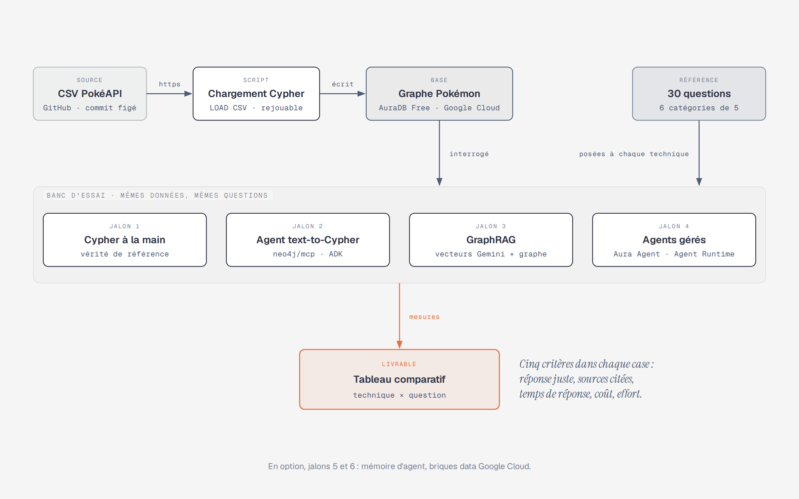

# node4jPOC · Banc d'essai agentique Neo4j

> **Initiative** · porteur : Julien Leroy · lancée le 2026-09-28 · **jalon 1 en cours**
>
> Suivi : [tableau Jira NEO](https://frjulienleroy.atlassian.net/jira/software/projects/NEO/boards/40) · [chronologie](https://frjulienleroy.atlassian.net/jira/software/projects/NEO/boards/40/timeline) · [ROADMAP](.claude/docs/ROADMAP.md)

## 🎯 Objectif

Choisir, preuves à l'appui, les techniques agentiques de Neo4j qui valent le coup. Quatre techniques répondent aux mêmes 30 questions, sur le même graphe Pokémon en français. Un tableau comparatif les départage sur cinq critères : réponse juste, sources citées, temps de réponse, coût, effort de mise en place.

## 🧭 Pourquoi

- **Apprendre en construisant.** Aucune stack n'est imposée : c'est le POC qui tranche, et chaque choix est expliqué.
- **Pouvoir le transposer** à une entreprise full Google Cloud ([ADR-0002](.claude/docs/adr/0002-cadrage-environnement-cible-google-cloud.md)). Chaque technique est mesurée dans sa variante Google Cloud : ADK, embeddings Gemini, Agent Runtime, Gemini Enterprise. dbt reste hors POC.

## 🗺️ Vue d'ensemble



Le graphe est chargé une seule fois, en Cypher pur, par un script rejouable. Les techniques ne font que le lire, avec les mêmes questions : seul l'écart entre leurs réponses compte. Composants et modèle du graphe : [ARCHITECTURE](.claude/docs/conception/ARCHITECTURE.md).

## 🚩 Jalons

Un jalon, c'est un epic Jira et une technique mesurée.

| Jalon | Résultat visé                                                  | Technique                         | Spec                                                              | Jira                                                      | État      |
| ----- | -------------------------------------------------------------- | --------------------------------- | ----------------------------------------------------------------- | --------------------------------------------------------- | --------- |
| 1     | Le graphe chargé et vérifié, avec les 30 réponses de référence | Cypher à la main                  | [001-socle-donnees](.claude/docs/specs/001-socle-donnees/spec.md) | [NEO-1](https://frjulienleroy.atlassian.net/browse/NEO-1) | en cours  |
| 2     | Un agent text-to-Cypher mesuré sur les 30 questions            | `neo4j/mcp`, agent ADK            | à écrire                                                          | [NEO-2](https://frjulienleroy.atlassian.net/browse/NEO-2) | à venir   |
| 3     | GraphRAG sur les descriptions, mesuré sur les 30 questions     | vecteurs Gemini et graphe         | à écrire                                                          | [NEO-3](https://frjulienleroy.atlassian.net/browse/NEO-3) | à venir   |
| 4     | Les agents gérés mesurés, le tableau comparatif livré          | Aura Agent, Agent Runtime         | à écrire                                                          | [NEO-4](https://frjulienleroy.atlassian.net/browse/NEO-4) | à venir   |
| 5     | La mémoire d'agent                                             | `neo4j-agent-memory`, Memory Bank | —                                                                 | —                                                         | en option |
| 6     | Les briques data Google Cloud                                  | Graph Analytics, CDC → Pub/Sub    | —                                                                 | —                                                         | en option |

## ✅ Critères de réussite

1. **Une vérité de référence** : les 30 questions ont leur réponse attendue, calculée en Cypher (jalon 1).
2. **Une mesure par technique** : chacune passe les 30 questions, notées sur les cinq critères, avec un score par catégorie ([ADR-0006](.claude/docs/adr/0006-mvp-banc-essai-30-questions.md)).
3. **Un tableau comparatif** qui croise technique et question, livré au jalon 4.
4. **Tout se rejoue** : le chargement ne crée aucun doublon, et les questions se relancent par script.

## 📦 Périmètre

| Dans l'initiative                                                   | Hors de l'initiative                                                                                            |
| ------------------------------------------------------------------- | --------------------------------------------------------------------------------------------------------------- |
| Les quatre techniques et leurs variantes Google Cloud               | dbt, qui relève de l'entreprise ([ADR-0002](.claude/docs/adr/0002-cadrage-environnement-cible-google-cloud.md)) |
| Les données PokéAPI, textes en français                             | Graph Data Science for BigQuery, encore expérimental                                                            |
| Les offres gratuites d'abord (AuraDB Free) : le coût est un critère | Spanner Graph, qui n'est plus Neo4j                                                                             |
| En option, à décider plus tard : les jalons 5 et 6                  | Tout usage hors apprentissage perso : l'univers Pokémon appartient à Nintendo                                   |

## ⚠️ Risques

- **La limite réelle d'AuraDB Free est inconnue** : 50 000 nœuds et 175 000 relations, ou 200 000 et 400 000 selon la source. À noter à la création de l'instance.
- **Une instance Free se met en pause** après 72 h sans activité, et disparaît après 30 jours de pause. Le chargement rejouable sert de filet.
- **Des coûts peuvent tourner en tâche de fond** : Aura Agent exposé, agent sur Agent Runtime, instance Business Critical. Tout éteindre après chaque session de mesure.
- **Plusieurs briques sont récentes ou en preview**, et leur doc est en retard : se fier aux notes de version.

## 🧱 Décisions

| ADR                                                                       | Décision                                          |
| ------------------------------------------------------------------------- | ------------------------------------------------- |
| [0001](.claude/docs/adr/0001-mvp-jeu-de-donnees-pokeapi.md)               | Jeu de données : Pokémon, CSV PokéAPI en français |
| [0002](.claude/docs/adr/0002-cadrage-environnement-cible-google-cloud.md) | Environnement cible Google Cloud, dbt hors POC    |
| [0003](.claude/docs/adr/0003-mvp-chargement-cypher-pur.md)                | Chargement en Cypher pur (`LOAD CSV`)             |
| [0004](.claude/docs/adr/0004-mvp-modele-espece-formes.md)                 | Modèle du graphe : l'espèce et toutes ses formes  |
| [0005](.claude/docs/adr/0005-mvp-conventions-nommage-schema.md)           | Conventions de nommage du schéma                  |
| [0006](.claude/docs/adr/0006-mvp-banc-essai-30-questions.md)              | Banc d'essai : 30 questions en 6 catégories       |

## 🔗 Suivi et documentation

- **Jira NEO** : le [tableau](https://frjulienleroy.atlassian.net/jira/software/projects/NEO/boards/40) et la [chronologie](https://frjulienleroy.atlassian.net/jira/software/projects/NEO/boards/40/timeline). Un epic par jalon, un ticket par phase de travail.
- **Dans le dépôt** : la [ROADMAP](.claude/docs/ROADMAP.md) pour l'état des jalons, le [cadrage](.claude/docs/cadrage/README.md) pour le besoin, les [30 questions](questions/README.md), l'[ARCHITECTURE](.claude/docs/conception/ARCHITECTURE.md).

## 🛠️ Démarrer

Prérequis : Java 21, `cypher-shell` 2026.09.0, une instance AuraDB Free et `gcloud` connecté au compte qui lit les secrets du projet `jleroy-labo` ([ACCESS](.claude/docs/ACCESS.md)).

```bash
git clone https://github.com/kurt83340/node4jPOC.git
cd node4jPOC
gcloud auth login             # identifiants lus dans Secret Manager : aucun fichier de secrets
pre-commit install            # garde-fou secrets : gitleaks avant chaque commit
scripts/charger.sh --ping     # Aura répond ? 0 oui, 2 erreur technique
scripts/charger.sh --go-no-go # contrôles en lecture seule avant chargement : 0 go, 1 no-go, 2 erreur technique
scripts/charger.sh --tout     # charge les fichiers cypher/ dans l'ordre ; une relance ne crée rien ; journal dans logs/
scripts/verifier.sh           # compare la base aux valeurs attendues : 0 conforme, 1 écart, 2 erreur technique
```

Le chargement se complète au fil de la spec 001, un fichier `cypher/` par groupe de données : `scripts/verifier.sh --section <nom>` contrôle chaque étape.

## Contact

- Owner technique : Julien Leroy (fr.leroyjulien@gmail.com)
- Owner business POC interne : Julien Leroy (fr.leroyjulien@gmail.com)

---

> 💡 Ce projet utilise le **[template Claude Code](.claude/STRUCTURE.md)** (convention 2026). Usage quotidien : [USAGE.md](.claude/USAGE.md).
